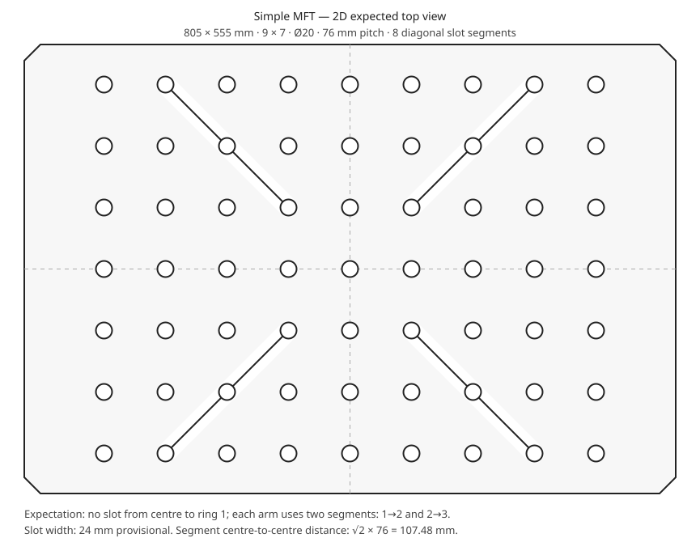

# Simple MFT

This model is a photo-based study of the CRAFTMAKER ProStation S30 replacement
worktop. It models the **worktop plate only**.

## Reference photo


This nearly front-on product image is the main visual reference because the
complete worktop, 9 × 7 hole grid and all eight clamp slots are visible at
once.

## 2D expectation



The 2D expectation is kept next to the model so the inferred layout can be
reviewed without opening SolidCraft.

## Known dimensions

Published replacement-top dimensions:

- 805 × 555 × 18 mm;
- Ø20 mm dog holes.

The front photo supports a 9 × 7 hole grid. The current pitch estimate is
76 mm in X and Y.

## Photo-based slot estimate

The front photo was aligned against the known worktop envelope and the visible
hole grid. The values below remain estimates rather than manufacturer
dimensions.

Eight slots are visible: two in each quadrant.

Current nominal values:

- slot width: **24 mm**;
- end-cap centre distance: **80 mm**;
- overall slot length: about **104 mm**;
- slot angle: approximately **45°**.

The inferred pattern in each quadrant is:

- the inner slot has one round-end centre at diagonal grid ring 1
  (`±76, ±76`) and extends outward;
- the outer slot has one round-end centre at diagonal grid ring 3
  (`±228, ±228`) and extends inward;
- the four diagonal grid-ring-2 positions (`±152, ±152`) do **not** contain
  dog holes; they are the clear gap between the two slots.

The model uses 80 mm centre-to-centre × 24 mm wide as the simple nominal Slot
size. That gives approximately 104 × 24 mm overall.

The 76 mm pitch, 20 mm corner cut and Slot dimensions are still estimates.

## Pattern

For one diagonal arm:

```text
centre

      Ø ring 1
       \
        \  inner Slot
         \
          · ring 2        <- no dog hole
           \
            \ outer Slot
             \
              Ø ring 3
```

The pattern is mirrored into all four quadrants. There is no Slot from the
plate centre to ring 1, and the four ring-2 diagonal grid positions are omitted
from the dog-hole set.

## Native SCPF construction

The CAD repository pins **SCPF 0.6.2**. This release fixes issue #266: fixed
native Slot coordinates stay fixed in a normal attached Sketch when the parent
Box has editable dimensions.

The worktop starts as one native `Box`. A native chamfer cuts the four
20 × 20 mm plan-view corners while keeping the rectangular Box as the base for
TOP-attached Sketches.

The nominal grid has 9 × 7 = 63 positions. The four diagonal ring-2 positions
are deliberately excluded, so the model creates **59 dog holes** in one
TOP-attached Sketch and cuts them through the plate in one operation. This is
clearer than creating a full 63-hole pattern and adding material back later.

The clamp geometry uses eight native `SlotCenterToCenter2D` profiles:

- four inner Slots start at ring 1 and extend 80 mm outward along the 45°
  diagonal;
- four outer Slots end at ring 3 and extend 80 mm inward along the same
  diagonal.

Each Slot Sketch is attached normally with
`Sketch(on=board, parent=Anchor.TOP)` and cut with
`Depth.THROUGH_ALL`. The model no longer needs an explicit numeric XY plane
as a workaround.

## Scope

Not included:

- frame or legs;
- guide rail;
- fence;
- dogs or clamps;
- logos and printed markings.

## Run

```powershell
python -m scpf models/advanced/simple_mft/scpf/model.py --out output/simple-mft.json
python -m scpf models/advanced/simple_mft/scpf/model.py --connect --new
```
